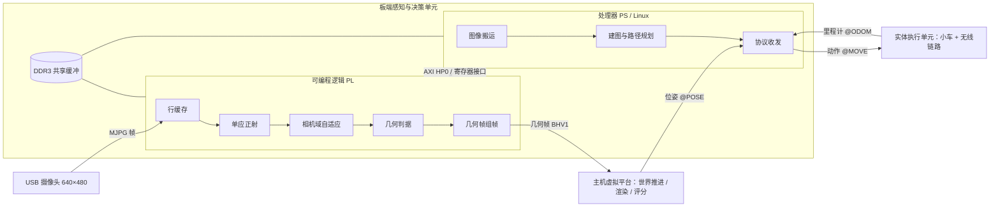
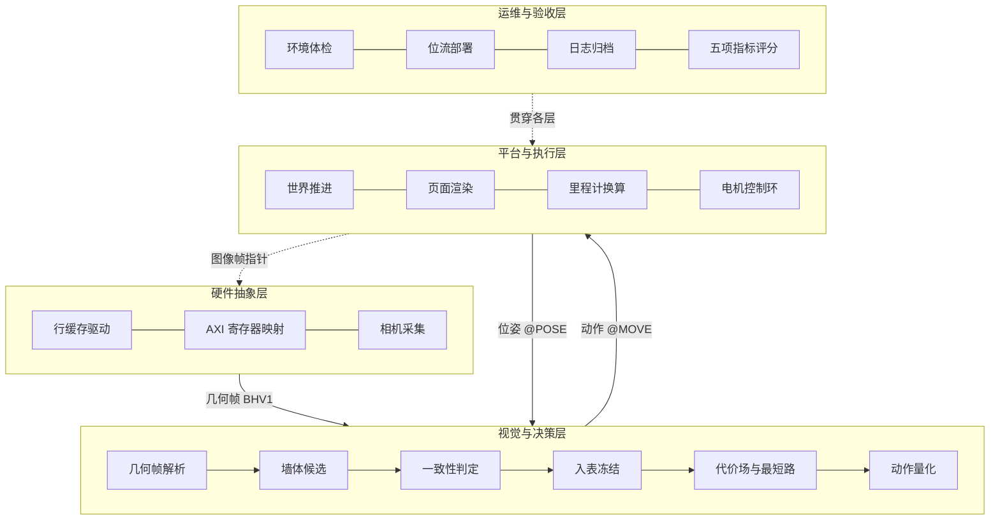
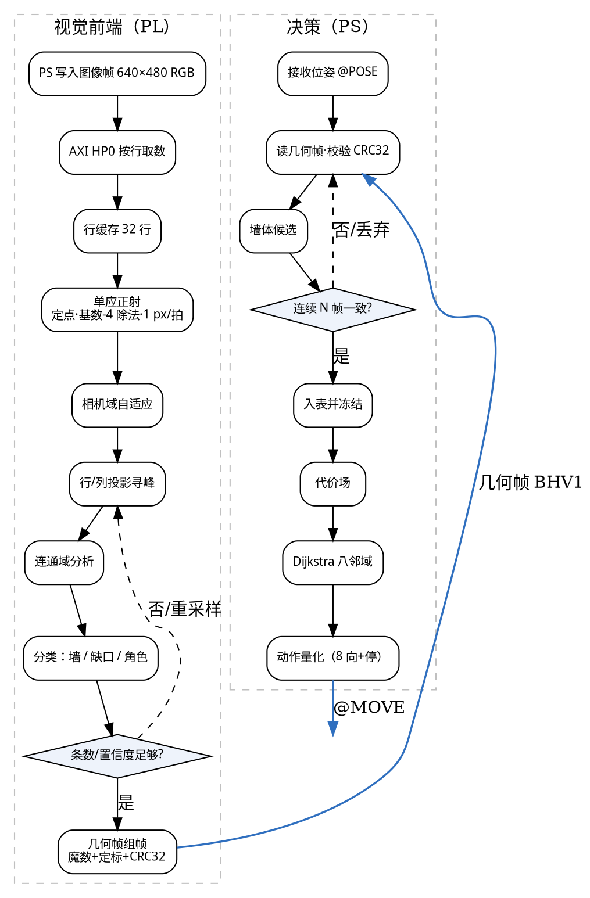

# 说明书插图：AI 生成提示词（共 4 张）

> 四张图依次为：图 1 系统总体框图 / 图 2 板端与小车驱动、编码器接口电路原理图 /
> 图 3 软件分层与数据流 / 图 4 视觉前端与决策流程图。
>
> 通用约定（四张图共用，保证风格一致）：
> 1. 白底、黑色等宽细线（0.5–0.75 pt）、圆角矩形（圆角 4 px）、单向箭头；
>    仅用一种强调色 `#2F6FBF` 标关键通路；无阴影、无渐变、无 3D、无拟物图标。
> 2. 中文标签统一用思源黑体/微软雅黑，字号一致（标签 ≥ 9 pt），英文与数字用 Times New Roman。
> 3. 比例：图 1、图 2、图 3 用 16:9；图 4 用 3:4 或 4:3（双泳道）。
> 4. 负面提示词（四张图通用）：`照片质感、3D 渲染、发光、霓虹、渐变、阴影、噪点、水印、
>    多余文字、中文字形错误、连线交叉混乱、图标拟物化、彩色玻璃、装饰边框`。
> 5. AI 生成中文小字常出错：可让模型"只出框与箭头、文字留空"，再用 PPT/Visio 贴字；
>    或直接采用文末 Mermaid / Graphviz 源码渲染（文字 100% 准确）。

---

## 图 1　系统总体框图

### 中文提示词

> 画一张"嵌入式视觉闭环系统"的工程总体框图，白底、黑色细线、圆角矩形、单向箭头，横向三段式，16:9。
> 左段大标题"板端感知与决策单元"，内含上下两个子块：上块"可编程逻辑 PL"，里面自左至右并排五个小方块
> "行缓存""单应正射""相机域自适应""几何判据""几何帧组帧"；下块"处理器 PS（Linux）"，里面三个小方块
> "图像搬运""建图与路径规划""协议收发"。PL 与 PS 之间画一条双向箭头，标注"AXI HP0 / 寄存器接口"。
> 中段大标题"主机虚拟平台"，内含三个小方块"世界真值推进""页面渲染""自动评分"，右上角标注"PC"。
> 右段大标题"实体执行单元"，内含"两轮自平衡小车""无线数传模块"两个小方块。
> 左外侧放一个"USB 摄像头 640×480"方块，箭头指向 PL 并标"MJPG 帧"；上方放"DDR3 共享缓冲"小方块，
> 用双线分别连到 PL 与 PS。
> 段间箭头：PL 右出 → 中段，标"几何帧 BHV1"；中段 → PS，标"位姿 @POSE"；
> PS 右出 → 右段，标"动作 @MOVE"；右段回 → PS，标"里程计 @ODOM"。
> 全图黑白加一种蓝色强调（仅标四类数据流），无阴影无渐变，文字为中文短标签。

### English prompt

> Engineering block diagram of an embedded vision closed-loop system, white background, thin uniform black
> lines, rounded rectangles, one-direction arrows, three horizontal sections, 16:9.
> Left: "Board unit" with "PL" (Line cache, Homography rectification, Camera-domain adaptation, Geometry
> decision, Frame assembly in a row) and "PS / Linux" (Frame transfer, Mapping & planning, Protocol I/O),
> connected by a bidirectional arrow labeled "AXI HP0 / registers".
> Middle: "Host virtual platform" (World truth update, Page rendering, Auto scoring), marked "PC".
> Right: "Physical unit" (Two-wheel self-balancing car, Wireless link).
> Outside: "USB camera 640×480" → PL labeled "MJPG frames"; "DDR3 shared buffer" with double lines to
> PL and PS. Inter-section arrows: PL → host "BHV1 geometry frame"; host → PS "pose @POSE";
> PS → car "action @MOVE"; car → PS "odometry @ODOM".
> Monochrome plus one blue accent, flat vector, short Chinese-style labels.

### 出图后校对
三段的先后关系（板端 → 主机 → 小车，位姿为回流）；PL 内五个处理块必须是**自左至右的流水**，
不是并列清单；两条协议箭头方向不可反。

---

## 图 2　板端与小车驱动、编码器接口电路原理图（双栏同图）

### 中文提示词

> 画一张双栏电路原理图，白底、黑色细线、标准电路符号（芯片用矩形并在内部写型号，电阻用矩形，
> 电容用两条平行线，电机用圆圈加"M"，编码器用方框加"A/B 相"字样），16:9，左右两栏之间用一条竖直虚线分隔，
> 虚线中间画一条连接两栏的虚线箭头并标注"串口/无线：@VEL、@ODOM"。
>
> 左栏标题"板端最小系统与图像通路"：
> 中心矩形"SoC（PS + PL）"，内部再分"PS：Cortex-A9 + Linux""PL：视觉流水"两个小块；
> 左上"电源树 12V → 5V → 3.3V / 1.8V / 1.0V"，三条支路箭头进 SoC 并标电压；
> 左下"DDR3 1GB"，用双线连 PS 并标"32 位数据总线"；
> 右上"QSPI / SD 卡"，箭头指 PL 标"位流加载"；
> 右下"USB 2.0 主机口"接"USB 摄像头"方块，标"MJPG 640×480"；
> 上方"千兆以太网 PHY"接 PS 标"RGMII"；下方"JTAG 调试"用虚线连 SoC；
> 右侧"AXI 寄存器组"小方块，连 PL 与 PS，标"帧长度 / 诊断计数"。
>
> 右栏标题"小车驱动与编码器接口"：
> 左芯片"STM32F103"，右芯片"TB6612FNG 双路 H 桥"，右下两个电机符号"M1 左轮""M2 右轮"，
> 中下两个编码器符号"ENC_L""ENC_R"（A/B 两相），右上"无线数传 433 MHz"，左上"MPU6050 六轴"。
> 连线与网络标签：
> ① PWM：PB0（TIM3_CH3）→ PWMB；PB1（TIM3_CH4）→ PWMA，标签 `PWM_B`、`PWM_A`；
> ② 方向：PB12 → BIN2、PB13 → BIN1、PB14 → AIN1、PB15 → AIN2，标签 `DIR_B2/B1/A1/A2`；
> ③ 电机：AO1/AO2 → M1，BO1/BO2 → M2；
> ④ 编码器：ENC_L 的 A/B → PA0/PA1（TIM2 编码器模式），ENC_R 的 A/B → PB6/PB7（TIM4 编码器模式），
>   每相串一只 10kΩ 上拉电阻到 3.3V；
> ⑤ 电源与去耦：VM 接 5V 并画 100μF 电解与 0.1μF 瓷片到地；VCC 接 3.3V；STBY 经 10kΩ 上拉；
> ⑥ 通信：USART1（PA9/PA10）↔ 无线数传模块，标签 `UART_TX/RX`；
> ⑦ 惯性：PB8/PB9 软 I²C ↔ MPU6050，标 `SCL`、`SDA` 并画上拉；
> ⑧ 地线统一汇到底部 GND 母线，每个器件旁画接地符号。

### English prompt

> Two-panel electronic schematic, white background, thin black lines, standard symbols, 16:9,
> a vertical dashed divider between panels with a dashed link labeled "serial/radio: @VEL, @ODOM".
> Left panel "Board minimal system and image path": central "SoC (PS+PL)" split into "PS: Cortex-A9 + Linux"
> and "PL: vision pipeline"; "Power tree 12V→5V→3.3V/1.8V/1.0V" with three branch arrows; "DDR3 1GB" with
> double lines labeled "32-bit bus"; "QSPI / SD" → PL "bitstream load"; "USB 2.0 host" → "USB camera"
> "MJPG 640×480"; "Gigabit Ethernet PHY" → PS "RGMII"; "JTAG" dashed; "AXI registers" block to PL and PS
> labeled "frame length / diagnostics".
> Right panel "Car driver and encoder interface": "STM32F103" left, "TB6612FNG" right, motors "M1 left",
> "M2 right" at bottom right, encoders "ENC_L/ENC_R" at bottom center, "433 MHz radio" top right,
> "MPU6050" top left. Nets: PB0→PWMB, PB1→PWMA (labels PWM_B/PWM_A); PB12/PB13→BIN2/BIN1,
> PB14/PB15→AIN1/AIN2 (DIR_x); AO1/AO2→M1, BO1/BO2→M2; ENC_L A/B→PA0/PA1 (TIM2 encoder mode),
> ENC_R A/B→PB6/PB7 (TIM4 encoder mode) with 10kΩ pull-ups to 3.3V; VM=5V with 100µF and 0.1µF decoupling;
> VCC=3.3V; STBY pulled up with 10kΩ; USART1 (PA9/PA10) ↔ radio labeled UART_TX/RX; PB8/PB9 soft I²C ↔
> MPU6050 labeled SCL/SDA with pull-ups; common GND bus at the bottom with ground symbols.
> Orthogonal wires, short net labels, no 3D, no photos.

### 出图后校对
① PWM 与方向脚必须与固件一致：**PB0/PB1 是 PWM**，**PB13/PB12、PB14/PB15 是方向**，**PA0/PA1 与 PB6/PB7 是编码器**；
② 两栏之间只有一条"协议"虚线，不要画成电源相连；③ 去耦电容与 STBY 上拉不能漏。

---

## 图 3　软件分层与数据流

### 中文提示词

> 画一张"四层软件栈 + 数据流"示意图，白底，每层一条浅灰横带（透明度 5%），带左侧竖排层名，
> 右侧横向排列圆角小卡片，卡片描边同色，16:9。
> 自上而下：
> 第一层"硬件抽象层"：卡片"行缓存驱动""AXI 寄存器映射""相机采集"；
> 第二层"视觉与决策层"：卡片"几何帧解析""墙体候选""一致性判定""入表冻结""代价场与最短路""动作量化"；
> 第三层"平台与执行层"：卡片"世界推进""页面渲染""里程计换算""电机控制环"；
> 第四层"运维与验收层"：卡片"环境体检""位流部署""日志归档""五项指标评分"。
> 层间用单向箭头并标注数据名：一→二层"几何帧 BHV1"；二→三层"动作编号 @MOVE"；
> 三层→二层画回流箭头"位姿 @POSE"；三层→一层画虚线回流"图像帧指针"；
> 第四层右侧画一条纵向虚线箭头，旁注"贯穿各层"。
> 全图黑白，箭头用单一蓝色；不画图标插画，字号统一。

### English prompt

> Four-layer software stack with data flow, white background, light gray horizontal bands (5% gray),
> rounded cards on the right of each band, 16:9. Layers: "Hardware abstraction" (line-cache driver, AXI
> register map, camera capture); "Vision & decision" (frame parsing, wall candidates, consistency check,
> table freeze, cost field & shortest path, action quantization); "Platform & execution" (world update,
> page rendering, odometry conversion, motor loop); "Ops & acceptance" (environment check, bitstream
> deployment, log archiving, five-metric scoring). Arrows between layers labeled "BHV1 geometry frame"
> (down), "action @MOVE" (down), "pose @POSE" (up, return), dashed "frame pointer" (up);
> a vertical dashed arrow on the right of layer 4 labeled "cross-cutting".
> Monochrome with one blue accent for arrows, flat vector, no icons.

### 出图后校对
四层的**顺序**（硬件 → 视觉决策 → 平台执行 → 运维）与箭头方向（@MOVE 向下、@POSE 向上回流）不可错；
第二层六个卡片是"一帧数据在层内的处理顺序"，建议按箭头串起来而不是纯并列。

---

## 图 4　视觉前端与决策流程图（双泳道）

### 中文提示词

> 画一张双泳道流程图，白底、黑色细线，左侧泳道标题"视觉前端（PL）"，右侧泳道标题"决策（PS）"，
> 两泳道之间用竖直虚线分隔；每个节点为圆角矩形，判断为菱形；比例 4:3。
> 左泳道自上而下九个节点：
> 1「PS 写入图像帧 640×480 RGB」
> 2「AXI HP0 按行取数」
> 3「行缓存 32 行（命中/缺失）」
> 4「单应正射（定点，基数-4 除法，1 px/拍）」
> 5「相机域自适应（增益/偏置）」
> 6「行/列投影寻峰」
> 7「连通域分析」
> 8「分类：墙 / 缺口 / 角色」
> 9「几何帧组帧（魔数 + 定标 + CRC32）」
> 左泳道内节点 8 后接菱形「条数或置信度不足？」，是 → 虚线回箭头到节点 6 标"重采样"，
> 否 → 节点 9。
> 节点 9 右侧画箭头跨到右泳道，箭头标注"几何帧 BHV1"。
> 右泳道自上而下七个节点：
> 1「接收位姿 @POSE（序号/坐标/朝向）」
> 2「读取几何帧并校验 CRC32」
> 3「墙体候选（相对量 ± 偏移）」
> 4「连续 N 帧一致性」→ 菱形「一致？」，否 →「丢弃候选」虚线回到节点 2；
> 5「入表并冻结（视觉不再刷新该墙）」
> 6「代价场（墙体斥力 + 走廊引导）」
> 7「Dijkstra 八邻域搜索」
> 8「动作量化（8 方向 + 停止）」→ 向泳道外画箭头标"@MOVE"
> 旁注：左泳道节点 4 旁"输入输出像素一一映射"；节点 3 旁"仅 32 行，省 BRAM"；
> 右泳道节点 4 旁"暂停采样 3 帧"；节点 7 旁"每 0.2 s 重规划"。
> 箭头向下、线宽一致，判断分支用细虚线，全图黑白加单一蓝色强调。

### English prompt

> Two-lane flowchart, white background, thin black lines, left lane "Vision front-end (PL)",
> right lane "Decision (PS)", vertical dashed divider, rounded nodes and decision diamonds, 4:3.
> Left lane top-down: "PS writes 640×480 RGB" → "Row fetch via AXI HP0" → "32-line cache (hit/miss)" →
> "Homography rectification (fixed-point, radix-4 divider, 1 px/cycle)" → "Camera-domain adaptation" →
> "Row/column projection peaks" → "Connected components" → "Classify: wall / gap / player" →
> "Frame assembly (magic + scale + CRC32)". A diamond after classification: "count/confidence sufficient?"
> no → dashed back arrow to projection peaks labeled "resample"; yes → assembly.
> Cross-lane arrow labeled "BHV1 geometry frame".
> Right lane top-down: "Receive pose @POSE" → "Read frame, verify CRC32" → "Wall candidates" →
> "N-frame consistency" diamond "consistent?" no → "discard" dashed arrow back to frame read;
> "Insert & freeze" → "Cost field (repulsion + corridor)" → "Dijkstra 8-neighbour" →
> "Action quantization" → out-arrow "@MOVE". Side notes: "1:1 pixel mapping", "only 32 rows",
> "pause sampling 3 frames", "replan every 0.2 s".
> Uniform downward arrows, dashed branches, one blue accent.

### 出图后校对
① 泳道归属：正射/行缓存/分类在左（PL），建图/搜索/动作在右（PS）；
② 跨泳道只有一条"几何帧 BHV1"（PL→PS），不要画反；
③ 两个判断菱形（置信度不足、帧间不一致）必须有回退虚线。

---

## 附：可保证文字准确的"代码出图"（推荐定稿用）

AI 生成适合定风格；定稿建议用下面源码渲染，文字与连线不会错。

### 图 1（Mermaid，粘贴到 mermaid.live / Typora）

### 图 3（Mermaid）

### 图 4（Graphviz，`dot -Tpng 图4.dot -o 图4.png`）

> 图 2 的原理图不建议用文生图定稿：按上面的结构与网络标签在立创 EDA / KiCad 里画一遍，
> 导出 300 dpi 图片再插入说明书。
