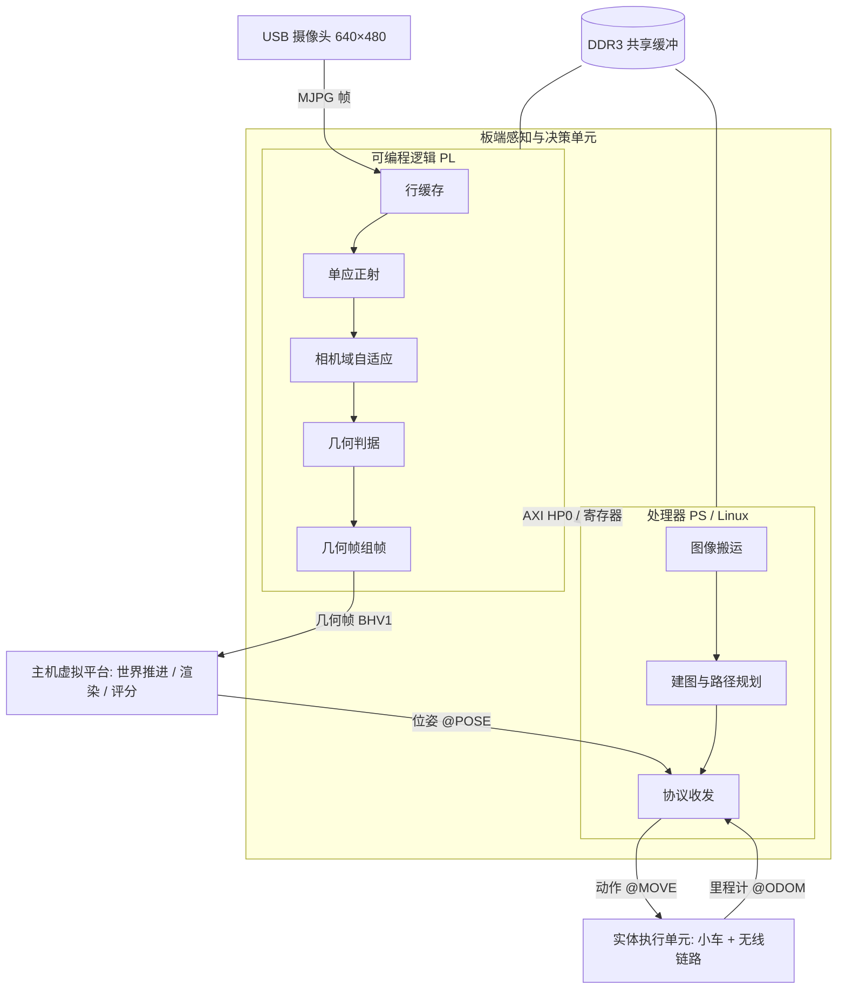
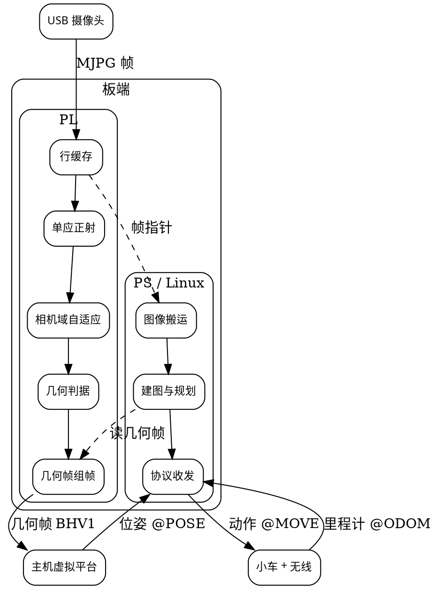

# 说明书插图：AI 生成提示词（图 2 / 图 4 / 图 5 / 图 6 / 图 7 / 图 8）

> 用途：把说明书里"图 2 系统总体框图、图 4 板端电路框图、图 5 小车驱动与编码器接口原理图、
> 图 6 软件分层与数据流、图 7 视觉前端流程图、图 8 决策流程图"交给文生图 / 图生图模型出草稿，
> 再人工校对文字与连线后定稿。
>
> 通用建议（先看这段，能省很多返工）：
> 1. **风格统一**：白底、黑色细线（线宽一致）、圆角矩形、单向箭头；只用一种强调色（如 #2F6FBF）；
>    不要阴影、渐变、3D、拟物、装饰边框。
> 2. **比例**：框图 16:9；原理图 3:2 或 4:3；流程图纵向 3:4。
> 3. **AI 写中文小字常出错**：建议让模型"只画框与箭头、文字留空"，出图后用 PPT / draw.io / Visio 贴文字；
>    或直接采用文末给出的 Mermaid / Graphviz 源码渲染（文字 100% 准确）。
> 4. **负面提示词统一用**：`照片质感、3D 渲染、发光、渐变、阴影、噪点、水印、多余文字、中文字形错误、
>    连线交叉混乱、图标拟物化、彩色玻璃、霓虹`。

---

## 图 2　系统总体框图

**中文提示词**

> 绘制一张"嵌入式视觉闭环系统"的工程总体框图，白底、黑色等宽细线、圆角矩形、单向箭头、横向三段式布局，比例 16:9。
> 左段标题"板端感知与决策单元"，内含上下两个子块：上块"可编程逻辑 PL"，其内自左至右排列五个小方块
> "行缓存""单应正射""相机域自适应""几何判据""几何帧组帧"；下块"处理器 PS（Linux）"，其内三个小方块
> "图像搬运""建图与路径规划""协议收发"。PL 与 PS 之间画双向箭头，标注"AXI HP0 / 寄存器接口"。
> 中段标题"主机虚拟平台"，内含三个小方块"世界真值推进""页面渲染""自动评分"，上方标"PC"。
> 右段标题"实体执行单元"，内含"两轮自平衡小车""无线数传模块"两个小方块。
> 从 PL 右边引出箭头指向中段，标"几何帧 BHV1"；中段到 PS 引回箭头，标"位姿 @POSE"；
> PS 到右段引出箭头，标"动作 @MOVE"；右段回箭头标"里程计 @ODOM"。
> 左侧外部输入块"USB 摄像头 640×480"，箭头指向 PL，标"MJPG 帧"；右上角小方块"DDR3 / 共享缓冲"，
> 用双线连到 PL 与 PS。整体只用黑白加一种蓝色强调，无阴影无渐变，图中文字为中文短标签。

**English prompt**

> A clean engineering block diagram of an embedded vision closed-loop system, white background, uniform thin
> black lines, rounded rectangles, one-direction arrows, three horizontal sections, 16:9.
> Left section "Board unit": upper block "PL" containing five small boxes in a row (Line cache, Homography
> rectification, Camera-domain adaptation, Geometry decision, Frame assembly); lower block "PS (Linux)"
> containing three small boxes (Frame transfer, Mapping & planning, Protocol I/O); a bidirectional arrow
> between them labeled "AXI HP0 / registers". Middle section "Host virtual platform" with three boxes
> (World truth update, Page rendering, Auto scoring). Right section "Physical unit" with two boxes
> (Two-wheel self-balancing car, Wireless link). Arrows: PL → host labeled "BHV1 geometry frame";
> host → PS labeled "pose @POSE"; PS → car labeled "action @MOVE"; car → PS labeled "odometry @ODOM".
> Left external block "USB camera 640×480" with arrow "MJPG frames" into PL; top-right small block
> "DDR3 shared buffer" connected to both PL and PS with double lines.
> Monochrome plus one blue accent, no shadows, no gradients, minimal flat vector style, leave text as
> short labels.

**出图后校对要点**：三段式是否横排；PL 内五个处理块是否自左至右成流水；两条协议箭头方向（@MOVE 向下、@POSE 向上）。

---

## 图 4　板端电路框图（2.2.3 用）

**中文提示词**

> 绘制"可编程片上系统板卡"的硬件电路框图，白底黑线、方框+引脚标注、比例 3:2。
> 中心大方块标"SoC（PS + PL）"，其右侧内部再分两个小方块"PS：Cortex-A9 + Linux""PL：视觉流水"。
> 围绕中心布置四组外围：左上"电源树 12V→5V→3.3V/1.8V/1.0V"，箭头指向中心并分三条支路标注电压；
> 左下"DDR3 1GB"，用双向双线连到 PS 并标"32 位数据总线"；
> 右上"配置存储器 QSPI / SD 卡"，箭头指向 PL 标"位流加载"；
> 右下"USB 2.0 主机口"，连到"USB 摄像头"小方块，标"MJPG 640×480"；
> 正上方"千兆以太网 PHY"连 PS，标"RGMII"；正下方"调试接口 JTAG"虚线路由到 SoC；
> 右侧另加一个"AXI 寄存器组"小方块，用箭头连 PL 与 PS，标"帧长度 / 诊断计数"。
> 所有连线为直角走线，交叉处不画连接点即为不连接，图例注明"实线=数据、双线=存储总线、虚线=配置/调试"。

**English prompt**

> Hardware block diagram of a SoC development board, white background, orthogonal wires, 3:2.
> Center "SoC (PS + PL)" split into "PS: ARM Cortex-A9 + Linux" and "PL: vision pipeline".
> Peripherals: top-left "Power tree 12V→5V→3.3V/1.8V/1.0V" with three branch arrows; bottom-left
> "DDR3 1GB" with double bidirectional lines labeled "32-bit data bus"; top-right "QSPI / SD card"
> arrow into PL labeled "bitstream load"; bottom-right "USB 2.0 host" to "USB camera" box labeled
> "MJPG 640×480"; top "Gigabit Ethernet PHY" to PS labeled "RGMII"; bottom "JTAG debug" dashed line;
> right "AXI register block" connected to PL and PS labeled "frame length / diagnostics".
> Legend: solid = data, double = memory bus, dashed = configuration/debug. Flat vector, monochrome + one accent.

---

## 图 5　小车驱动与编码器接口原理图

**中文提示词**

> 绘制一张"双路直流电机驱动与编码器接口"的原理图，白底、黑色细线、标准电路符号（电阻用方框、
> 电容用两条平行线、芯片用矩形并在内部标型号），比例 4:3，网格对齐。
> 左侧芯片"STM32F103"，右侧芯片"TB6612FNG 双路 H 桥"，右下两个电机符号"M1 左轮""M2 右轮"，
> 中下两个编码器符号"A/B 相正交输出"。
> 连线与标注：
> ① PWM：STM32 的 PB0(TIM3_CH3) → TB6612 的 PWMB；PB1(TIM3_CH4) → PWMA；
> ② 方向：PB12/PB13 → BIN2/BIN1，PB14/PB15 → AIN1/AIN2；
> ③ 电机输出：AO1/AO2 → M1，BO1/BO2 → M2；
> ④ 编码器：M1 的 A/B 相 → PA0/PA1（TIM2 编码器模式），M2 的 A/B 相 → PB6/PB7（TIM4 编码器模式），
>   每相各串一只上拉电阻画到 3.3V；
> ⑤ 电源：VM 接 5V 并画 100μF 电解电容与 0.1μF 瓷片电容去耦；VCC 接 3.3V；STBY 经 10kΩ 上拉到 3.3V；
> ⑥ 地线统一画到底部 GND 母线并在每个器件处画接地符号。
> 所有网络标签用短横线+文字（如 PWM_A、DIR_A1），不画交叉斜线，不画实物图。

**English prompt**

> A schematic of a dual DC motor driver and quadrature encoder interface, white background, standard
> electrical symbols, 4:3, grid-aligned. Left IC "STM32F103", right IC "TB6612FNG", two motor symbols
> "M1 left / M2 right", two encoder symbols "A/B quadrature" at bottom center.
> Nets: PB0 (TIM3_CH3) → PWMB; PB1 (TIM3_CH4) → PWMA; PB12/PB13 → BIN2/BIN1; PB14/PB15 → AIN1/AIN2;
> AO1/AO2 → M1; BO1/BO2 → M2; M1 A/B → PA0/PA1 (TIM2 encoder mode); M2 A/B → PB6/PB7 (TIM4 encoder mode),
> each phase with a pull-up resistor to 3.3V; VM = 5V with 100µF and 0.1µF decoupling; VCC = 3.3V;
> STBY pulled up via 10kΩ; a common GND bus at the bottom with ground symbols.
> Use short net labels (PWM_A, DIR_A1, ENC_L_A …), orthogonal wires, no 3D, no photos.

**出图后校对要点**：PWM 与方向脚是否与固件一致（PB0/PB1 为 PWM，PB13/PB12 与 PB14/PB15 为方向，PA0/PA1 与 PB6/PB7 为编码器）。

---

## 图 6　软件分层与数据流

**中文提示词**

> 绘制"四层软件栈与数据流"示意图，白底、浅灰分层底板（三层横向带状）、黑色细线，比例 16:9。
> 自上而下四层，每层左侧竖排层名、右侧横向排列模块卡片：
> 第一层"硬件抽象层"：卡片"行缓存驱动""AXI 寄存器映射""相机采集"；
> 第二层"视觉与决策层"：卡片"几何帧解析""墙体候选""一致性判定""入表冻结""代价场与最短路""动作量化"；
> 第三层"平台与执行层"：卡片"世界推进""页面渲染""里程计换算""电机控制环"；
> 第四层"运维与验收层"：卡片"环境体检""位流部署""日志归档""五项指标评分"。
> 层间画单向箭头并标注数据名：第一层→第二层标"几何帧 BHV1"；第二层→第三层标"动作编号 @MOVE"；
> 第三层→第二层画回流箭头标"位姿 @POSE"；第三层→第一层画虚线回流标"图像帧指针"；
> 第四层用虚线箭头旁注"贯穿各层"。
> 卡片圆角 4 像素、描边同色；层带用 5% 灰；强调色仅用于箭头，无阴影、无图标化插画，中文字号统一。

**English prompt**

> A four-layer software stack with data flow, white background, light gray horizontal bands, thin lines,
> 16:9. Layers top to bottom: "Hardware abstraction" (line-cache driver, AXI register map, camera capture);
> "Vision & decision" (frame parsing, wall candidates, consistency check, table freeze, cost field &
> shortest path, action quantization); "Platform & execution" (world update, page rendering, odometry
> conversion, motor control loop); "Ops & acceptance" (environment check, bitstream deployment, log
> archiving, five-metric scoring). Arrows between layers labeled "BHV1 geometry frame" (down),
> "action @MOVE" (down), "pose @POSE" (up), dashed "frame pointer" (up); dashed arrow beside layer 4
> labeled "cross-cutting". Uniform rounded cards, one accent color for arrows only, flat vector.

---

## 图 7　视觉前端流程图

**中文提示词**

> 绘制纵向流程框图（自上而下 9 个圆角矩形，右侧可加旁注），白底黑线，比例 3:4，节点内文字居中。
> 节点依次为：
> 1「PS 写入图像帧（640×480 RGB）」
> 2「PL 经 AXI HP0 按行取数」
> 3「行缓存 32 行（命中/缺失判定）」
> 4「单应正射（定点，基数-4 除法，每拍 1 像素）」
> 5「相机域自适应（增益/偏置）」
> 6「行投影与列投影寻峰」
> 7「连通域分析」
> 8「实体分类：墙 / 缺口 / 角色」
> 9「几何帧组帧（魔数 + 定标 + CRC32）→ 写 DDR 并置完成标志」
> 节点 8 右侧引出一个判断菱形「条数或置信度不足？」，是 → 回箭头到节点 6 并标"重采样"，
> 否 → 进入节点 9。节点 4 右侧旁注"输出像素与输入坐标一一映射"；节点 3 右侧旁注"仅保留 32 行，省 BRAM"。
> 箭头统一向下、线宽一致，判断分支用细虚线，全图只用一种蓝色强调。

**English prompt**

> Vertical flowchart, 9 rounded nodes top-down, white background, 3:4, centered labels:
> "PS writes 640×480 RGB frame" → "PL reads rows via AXI HP0" → "32-line cache (hit/miss)" →
> "Homography rectification (fixed-point, radix-4 divider, 1 px/cycle)" → "Camera-domain adaptation" →
> "Row/column projection peak finding" → "Connected-component analysis" → "Classification: wall / gap / player" →
> "Geometry frame assembly (magic + scale + CRC32) → write DDR + ready flag". A decision diamond after
> classification: "insufficient count/confidence?" yes → back arrow to projection step labeled "resample";
> no → assembly. Side notes: "1:1 pixel mapping" beside rectification, "keep only 32 rows" beside cache.
> Uniform downward arrows, dashed branch, one accent color, flat vector.

---

## 图 8　决策流程图

**中文提示词**

> 绘制纵向流程图，白底黑线、圆角矩形与判断菱形混排，比例 3:4，节点文字居中。
> 节点依次：
> 1「接收位姿 @POSE（序号 + x + y + 朝向）」
> 2「读取几何帧（校验 CRC32）」
> 3「墙体候选（相对量 ± 偏移）」
> 4「连续 N 帧一致性判定」——菱形「一致？」
>   否 →「丢弃该候选」→ 回到节点 2；
>   是 → 5「入表并冻结（此后视觉不再刷新该墙）」
> 6「构建代价场（墙体斥力 + 走廊引导）」
> 7「图搜索（Dijkstra / 八邻域）」
> 8「动作量化（8 方向 + 停止）」
> 9「输出 @MOVE 并记录到事件日志」
> 节点 4 右侧旁注"暂停采样窗口 = 3 帧"；节点 7 右侧旁注"每 0.2 s 重规划一次"。
> 判断菱形用细实线，回退连线用细虚线并标"丢弃/重试"；全图黑白 + 单一蓝色强调，无阴影。

**English prompt**

> Vertical decision flowchart with rounded boxes and diamonds, white background, 3:4:
> "Receive pose @POSE (seq, x, y, heading)" → "Read geometry frame (CRC32 check)" →
> "Wall candidates (relative offsets)" → diamond "consistent over N frames?" no → "discard candidate"
> → back to frame read; yes → "insert & freeze in map" → "Build cost field (wall repulsion +
> corridor guidance)" → "Graph search (Dijkstra, 8-neighbour)" → "Action quantization (8 directions + stop)" →
> "Emit @MOVE and log event". Side notes: "pause-sampling window = 3 frames", "replan every 0.2 s".
> Dashed retry arrows, one accent color, flat vector.

---

## 附：可保证文字 100% 准确的替代写法（推荐定稿用）

AI 出图适合定风格，定稿建议用下面两种"代码出图"，再导出 PNG/PDF 贴进说明书。

### 1) Mermaid（可直接在 Typora / VS Code / mermaid.live 渲染）

### 2) Graphviz（`dot -Tpng` 出图）

> 电子原理图更建议用立创 EDA / KiCad / Visio 的"原理图库"直接画（符号与网络标签规范、可直接导出 300 dpi 图）；
> 若仍用文生图，请按下文"图 5"提示词生成结构草图，再用 EDA 重绘定稿。
